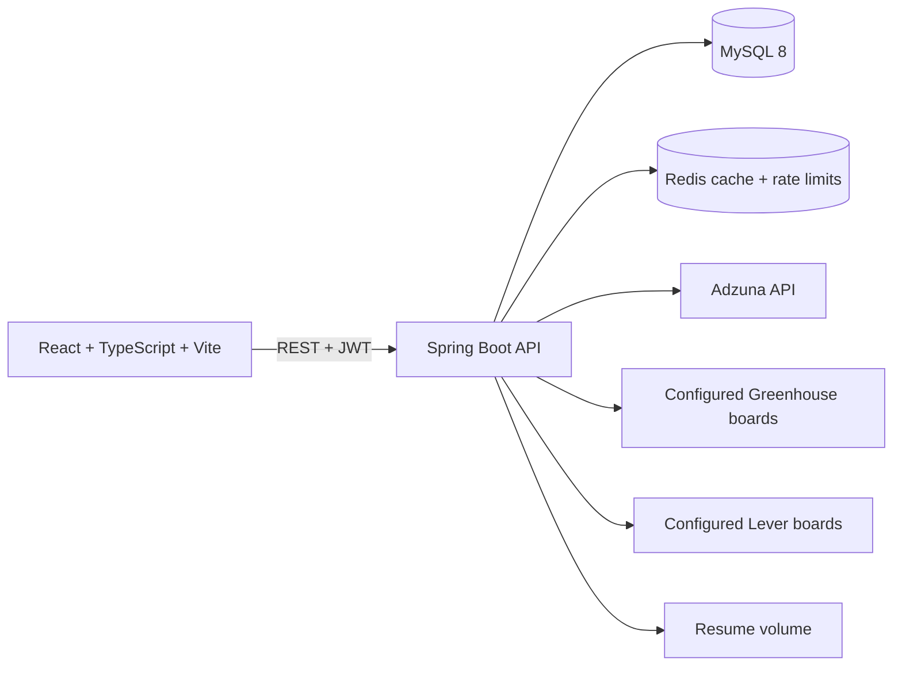

# CareerNexus AI

CareerNexus is a full stack job search and application tracking application. The backend queries only configured external sources, normalizes their responses, records the source's original application URL, and returns the real count from the current provider search. There is no generated or seeded job data. Country and skill reference data are generated locally; job listings are never seeded.

Stack: Java 21 and Spring Boot 3.5.16; Spring Security, JPA/Hibernate, Flyway, JWT, Actuator, Redis, Maven, and MySQL 8; React 18, TypeScript, Vite, React Router, Axios, Tailwind, and React Query.

## Architecture



The Spring API owns authentication, search, normalization, deduplication, filtering, recommendation scoring, and user job tracking. Each job source implements the same provider interface. Search calls every enabled provider, upserts the returned records, associates those records with the current search run, and applies filters and pagination in MySQL. The response total therefore counts the current providers' matching results, not a guessed global inventory. A provider failure is returned as a warning when another configured provider succeeds; when every enabled provider fails the API returns a gateway error.

Recommendations use a configurable, explainable weighted score (required skills 40%, experience 25%, location 15%, title 10%, additional skills 10% by default). Scores are profile-fit estimates, not employer decisions or hiring probabilities. Required and preferred experience are stored separately. An experience selection affects ranking and recommendation scoring; it does not remove broader experience ranges from search results.

## Project structure

```text
.
├── backend/
│   ├── Dockerfile
│   ├── pom.xml
│   └── src/
│       ├── main/java/com/careernexus/
│       │   ├── application/       # Saved jobs, applications, search history
│       │   ├── auth/              # Registration, JWT login, password reset
│       │   ├── common/            # Consistent API responses and error handling
│       │   ├── company/
│       │   ├── config/            # Security, cache, seeds, scheduler, OpenAPI
│       │   ├── dashboard/
│       │   ├── job/               # Search, normalized job records, scoring views
│       │   ├── location/          # Countries and available cities
│       │   ├── profile/           # Profile and resume storage
│       │   ├── provider/          # Adzuna, Greenhouse and Lever adapters
│       │   ├── recommendation/
│       │   ├── security/          # JWT filter and API rate limiting
│       │   ├── skill/
│       │   └── user/
│       ├── main/resources/
│       │   ├── application.yml
│       │   └── db/migration/      # Flyway schema migrations
│       └── test/java/com/careernexus/
├── frontend/
│   ├── Dockerfile
│   ├── nginx.conf
│   └── src/
│       ├── api/                   # Typed Axios API clients
│       ├── auth/
│       ├── components/
│       └── pages/                 # Landing, dashboard, search, profile, etc.
├── .env.example
├── docker-compose.yml
└── README.md
```

## Database relationships

- `users` has one `user_profiles` row and many saved jobs, applications, search-history rows, and recommendations.
- `user_profiles` and `skills` are many-to-many through `user_skills`.
- `jobs` optionally belongs to a `company`, has many `job_sources`, and has separate required and preferred skill joins (`job_required_skills`, `job_additional_skills`). A job can have multiple provider sources; provider ID and canonical URL constraints prevent duplicate records.
- `saved_jobs` and `job_applications` associate users and jobs, each with a unique user/job pair. Applications hold status, interview date, notes, and update time.
- `search_history` belongs to a user and associates the exact job set returned during that search through `search_history_jobs`.
- `job_recommendations` stores a user's calculated score and JSON explanation per job.
- `countries` and `locations` provide reference data. ISO country rows and a small India city starter list are local reference records, not job data. Locations are also learned from connected job records.

Flyway owns schema changes; Hibernate runs in `validate` mode. Indexes cover job availability/date/location/company, user activity, and provider identifiers.

## REST API

All successful responses use `{ "success": true, "data": ..., "message": null }`; errors use the same shape with `success: false`. Protected routes require `Authorization: Bearer <token>`.

| Area | Endpoint | Purpose |
|---|---|---|
| Auth | `POST /api/auth/register` | Register and create a profile |
| Auth | `POST /api/auth/login` | Get a JWT |
| Auth | `POST /api/auth/forgot-password` | Send reset instructions when SMTP is configured |
| Auth | `POST /api/auth/reset-password` | Redeem a one-use, expiring reset token |
| Profile | `GET /api/users/profile` | Read profile and skills |
| Profile | `PUT /api/users/profile` | Update profile, location, skills, experience |
| Profile | `POST /api/users/profile/resume` | Upload PDF, DOC or DOCX (up to 5 MB) |
| Profile | `GET /api/users/profile/resume` | Download the signed-in user's resume |
| Locations | `GET /api/countries` | List ISO countries |
| Locations | `GET /api/countries/{code}/locations` | List known cities for a country |
| Skills | `GET /api/skills` | List the built-in and custom skill catalog |
| Skills | `POST /api/skills` | Add a custom skill |
| Search | `GET /api/jobs/search` | Search providers and return a filtered page |
| Jobs | `GET /api/jobs/{id}` | Read job detail and profile match |
| Jobs | `GET /api/jobs/recommended` | Get a page of current profile recommendations |
| Saved jobs | `POST /api/jobs/{id}/save` | Save a job |
| Saved jobs | `DELETE /api/jobs/{id}/save` | Remove a saved job |
| Saved jobs | `GET /api/jobs/saved` | List saved jobs |
| Applications | `POST /api/applications` | Create or update an application record |
| Applications | `GET /api/applications` | List application tracker entries |
| Applications | `PUT /api/applications/{id}` | Update status, interview date, notes |
| Applications | `DELETE /api/applications/{id}` | Remove an application record |
| Dashboard | `GET /api/dashboard/summary` | Counts and job/application breakdowns |
| Health | `GET /actuator/health` | Health status |
| OpenAPI | `/swagger-ui.html` | Interactive API documentation |

Search accepts `country` (ISO alpha-2), `state`, `city`, repeated or comma-separated `skills`, `experienceYears`, `employmentType`, `workMode`, `minSalary`, `maxSalary`, `salaryCurrency`, `salaryInterval`, `postedWithinDays`, `company`, `title`, `page`, `size` (max 100), and `sort` (`newest`, `salary`, `match`). Salary comparisons require a currency and pay period and do not convert between currencies or periods.

## Job provider strategy and configuration

Each adapter speaks to a documented public API/feed and maps source IDs, descriptions, dates, compensation, locations, and original URLs into the shared `ProviderJob` format. Provider keys stay in backend environment variables. Provider results are cached briefly in Redis and upserted into MySQL. Jobs are marked inactive after 21 days without a successful verification. The app does not scrape HTML career pages.

- **Adzuna:** configure `ADZUNA_APP_ID` and `ADZUNA_APP_KEY`. Requests use the selected country's API endpoint and city/title/skills query. The page cap is `ADZUNA_MAX_PAGES` (1–20, default 5; up to 50 items per page). Adzuna requires its attribution link in the UI. Review the current [API search documentation](https://developer.adzuna.com/docs/search), [API overview](https://developer.adzuna.com/overview), and [terms of service](https://developer.adzuna.com/docs/terms_of_service). The terms describe limited non-commercial use and say commercial use requires a separate licence; verify that your intended deployment is covered before launch.
- **Greenhouse:** configure comma-separated public board tokens in `GREENHOUSE_BOARDS`, e.g. `company-a,company-b`. The adapter calls Greenhouse's public Job Board API, including job descriptions, and displays Greenhouse attribution. See the [official Job Board API docs](https://docs.greenhouse.io/job-board).
- **Lever:** configure comma-separated public site names in `LEVER_BOARDS`, e.g. `company-a,eu:company-b`. Use `eu:` for Lever's EU host. See the [official Postings API](https://github.com/Lever/postings-api).

Greenhouse and Lever require you to choose the board/site identifiers to connect. These feeds do not provide a single global company directory. Configure only boards whose public feed you are authorized to use and follow each provider's rate limits and terms. With no enabled providers, search returns HTTP 503 with a setup message; the application does not fabricate fallback listings.

## Run locally with IntelliJ IDEA

Requirements: Java 21, Maven 3.9+, Node.js 20+, npm, Docker Desktop, and provider configuration for real job results.

1. Copy `.env.example` to `.env` and set database credentials, a private `JWT_SECRET`, and any source credentials/board IDs. Keep `.env` out of version control.
2. Start MySQL and Redis: `docker compose up -d mysql redis`.
3. Open `backend/pom.xml` as a Maven project in IntelliJ IDEA and use the project JDK 21. Run `com.careernexus.CareerNexusApplication`, or from `backend/` run `mvn spring-boot:run`. Flyway creates and migrates the schema on startup.
4. From `frontend/`, run `npm ci` then `npm run dev`. Open `http://localhost:5173`.
5. Create an account. Without a configured provider, job search reports the source setup requirement. For password recovery, configure SMTP; the endpoint intentionally does not disclose account existence.

API defaults to `http://localhost:8080`; Swagger is at `http://localhost:8080/swagger-ui.html`. The frontend uses `VITE_API_URL` (defaults to `http://localhost:8080/api`). Configure `CORS_ALLOWED_ORIGINS` for the frontend origin.

## Run with Docker Compose

Copy `.env.example` to `.env`, replace development secrets and configure providers, then run `docker compose up --build`. The web app is at `http://localhost:4173`, API at `http://localhost:8080`, MySQL at `localhost:3306`, and Redis at `localhost:6379`. Compose persists database, Redis, and uploaded resume data in named volumes. To start only local infrastructure for IntelliJ and Vite, run `docker compose up -d mysql redis`.

## Build and tests

```powershell
cd backend
mvn test
cd ..\frontend
npm ci
npm run build
```

Backend unit tests cover experience extraction and recommendation matching. `npm run build` runs the TypeScript compiler and Vite production build. No third-party API calls are required for unit tests. Integration verification against MySQL, Redis, SMTP, or provider accounts requires those services and credentials.

## Operational notes

- Redis backs short-lived provider/reference-data caching and per-IP API rate limits; the rate limiter falls back to a bounded in-memory window if Redis is unavailable.
- Resume files are stored under `UPLOAD_DIRECTORY` (Docker uses a named volume). Back up that volume with the database if retaining uploaded resumes.
- Password-reset links expire after 30 minutes and tokens are stored as hashes. SMTP is optional until reset email is requested.
- Actuator exposes health, info, and metrics. Job availability is based on the real records recently verified by configured sources; the dashboard does not claim provider-wide totals or job expiry when sources do not expose that data.
